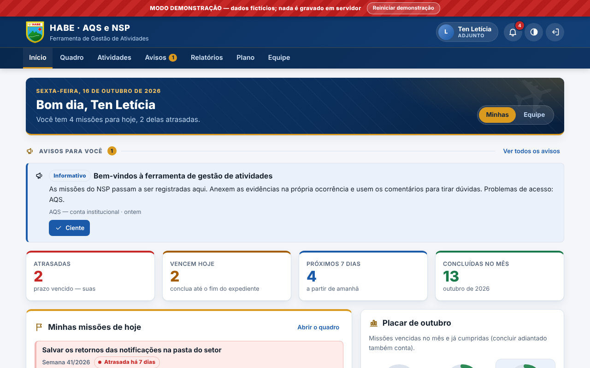
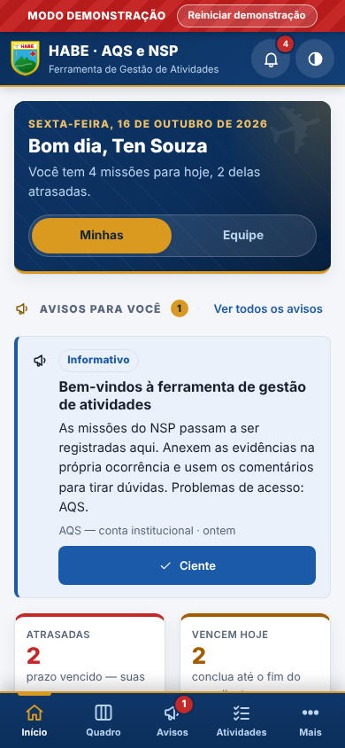
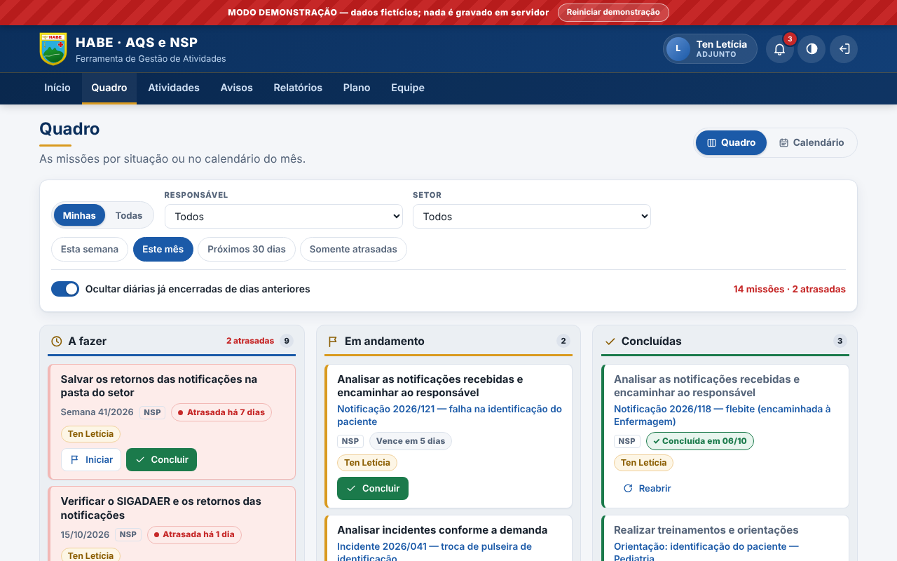
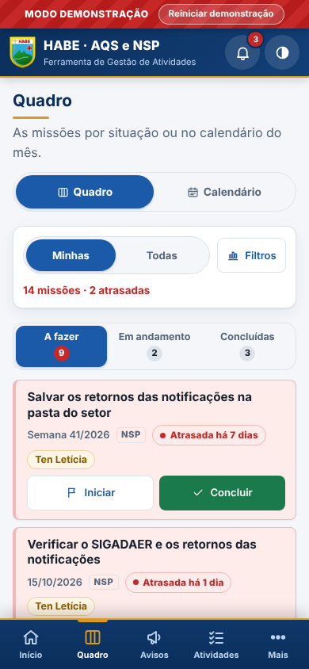

# HABE · AQS e NSP — Ferramenta de Gestão de Atividades

Ferramenta da **Assessoria de Qualidade e Segurança (AQS)** e do **Núcleo
de Segurança do Paciente (NSP)** do **Hospital de Aeronáutica de Belém**
para organizar as missões da equipe: o que cada um tem de fazer, até
quando, o que já foi feito e a evidência de que foi feito — no computador
e no celular, com atualização em tempo real.

**Para quem:** os adjuntos do NSP (executam e registram as suas missões),
a chefia (gerencia atividades, avisos e a equipe) e a **conta institucional
da AQS**, que mantém a ferramenta administrável quando as pessoas mudam.

| Documento | Para quem |
|---|---|
| [Manual do usuário](docs/MANUAL.md) | Toda a equipe |
| [Implantação](docs/IMPLANTACAO.md) | Quem vai colocar a ferramenta no ar |
| [Plano de continuidade](docs/CONTINUIDADE.md) | Chefia e AQS — o que fazer quando alguém sai, rotinas e emergências |
| [Arquitetura](docs/ARQUITETURA.md) | Quem mantém o código |

---

## Principais funcionalidades

| Computador | Celular |
|---|---|
|  |  |
|  |  |

- **Início** — missões de hoje e dos próximos 7 dias, atrasadas,
  indicadores, avisos que aguardam ciência, placar do mês e sequências das
  atividades diárias. Para os gestores, as pendências da equipe e os
  **alertas de continuidade**.
- **Quadro e Calendário** — as missões em *A fazer · Em andamento ·
  Concluídas* ou no calendário do mês, com filtros por responsável, setor e
  período. No celular, abas e agenda em lista.
- **Detalhe da missão** — situação, observação, **evidências** (PDF, Word,
  Excel, PowerPoint, fotos; foto direto da câmera do celular) e
  **comentários**.
- **Atividades** — recorrentes (diária em dias úteis, semanal, mensal,
  trimestral, semestral, anual, com antecipação para o dia útil anterior em
  feriados), pontuais e sob demanda; o sistema cria cada prazo sozinho.
  Vem com as 16 atividades do plano do NSP.
- **Avisos** — comunicados da chefia com nível, prazo, destinatários e
  registro de **"Ciente"**.
- **Notificações** — nova missão, comentário, aviso e prazo de hoje ou
  amanhã, no sino e em tempo real.
- **Relatórios** — % de cumprimento e % no prazo por militar, setor e
  atividade; atrasadas em aberto; CSV e impressão/PDF.
- **Plano de Atividades** — o documento institucional gerado do cadastro:
  imprimir/PDF com o brasão, Word (.doc) e planilha (CSV).
- **Equipe** — incluir, alterar (inclusive o papel), desativar e **excluir
  qualquer militar, inclusive a chefia**; criar acesso com senha
  temporária, redefinir senha, remover o segundo fator, trocar o e-mail de
  login; **passagem de chefia** guiada; setores; feriados; **continuidade**
  (contatos institucionais, cópia de segurança, gestores com acesso);
  **auditoria**.
- **Minha conta** — senha, verificação em duas etapas, tema claro/escuro,
  sair de todos os dispositivos. Instalável na tela inicial do celular.

---

## Experimentar (modo demonstração)

O arquivo **`demo.html`** abre as mesmas telas com **dados fictícios**,
sem servidor e sem gravar nada fora do navegador (a faixa vermelha "MODO
DEMONSTRAÇÃO" fica sempre visível). Na tela de login, escolha um perfil em
"Entrar como…" — conta institucional, chefia ou um adjunto; qualquer senha
serve.

- No site publicado: `https://<endereço-da-ferramenta>/demo.html`.
- No computador, a partir de uma cópia do repositório: abra
  `aqs-nsp/demo.html` com dois cliques (Chrome ou Edge) ou, com Node.js
  instalado:

  ```bash
  npx http-server aqs-nsp -p 8080
  # depois abra http://localhost:8080/demo.html
  ```

Os dados da demonstração ficam só naquela aba e voltam ao início com o
botão "Reiniciar demonstração".

---

## Implantar

Resumo — o passo a passo completo, testável e com tudo em nome do **e-mail
institucional da AQS**, está em **[docs/IMPLANTACAO.md](docs/IMPLANTACAO.md)**:

1. Conta GitHub institucional e o repositório transferido para ela.
2. Projeto no **Supabase** (região São Paulo) com o e-mail institucional.
3. Rodar no SQL Editor `supabase/01` a `04` (estrutura, segurança, tempo
   real/rotina diária e dados iniciais).
4. Conferir o bucket privado `evidencias` e as regras de login
   (cadastro fechado, senha de 10+ com letras e números, 2FA).
5. Preencher `assets/js/config.js` (endereço e chave **pública** do projeto,
   contato de suporte).
6. Publicar a pasta `aqs-nsp/` no **Cloudflare Pages** ou no **Netlify**
   (sem build; os cabeçalhos de segurança vêm de `_headers`).
7. Publicar a Edge Function `admin-usuarios` com o segredo
   `ORIGEM_PERMITIDA` (endereço do site).
8. Criar o login da conta institucional, ligá-lo com
   `select privado.vincular_usuario('e-mail-institucional')`, entrar e
   cadastrar a chefia e os adjuntos pela tela Equipe.
9. Roteiro de conferência (login, 2FA, anexos, tempo real, acesso
   negado, celular).

---

## Segurança — o que protege os dados

- **Ninguém se cadastra sozinho.** Só os gestores criam acessos; a senha
  temporária aparece uma única vez e a troca é obrigatória no primeiro
  login. Senha mínima de 10 caracteres com letras e números; verificação em
  duas etapas (aplicativo autenticador) disponível para todos e exigida
  para administrar usuários de quem a ativou.
- **Regras no banco, não só na tela.** Cada tabela tem regras de acesso
  (RLS) no PostgreSQL: quem não fez login não lê nada; cada papel só faz o
  que lhe cabe; **desativar um militar corta o acesso na hora**, mesmo com
  a sessão aberta. A tela apenas esconde botões — quem recusa é o servidor.
- **Arquivos em bucket privado**, com limite de 20 MB e lista fechada de
  tipos; envio só por responsáveis e gestores. As telas lembram que **dados
  de pacientes não entram** na ferramenta (LGPD).
- **A chave-mestra do Supabase nunca chega ao navegador**: as operações de
  usuário passam pela Edge Function `admin-usuarios`, que confere o papel de
  quem pede, aceita só o endereço oficial do site (`ORIGEM_PERMITIDA`) e
  registra tudo na auditoria (nunca a senha).
- **Continuidade protegida:** só a conta institucional mexe em contas de
  administrador, e o banco recusa qualquer operação que deixe o sistema sem
  um gestor ativo com acesso.
- **Auditoria** de cada inclusão, alteração e exclusão, com o nome de quem
  fez; excluir um militar preserva o histórico com o nome gravado.
- **Navegador blindado:** política de segurança de conteúdo (CSP) rígida —
  sem scripts ou estilos embutidos, sem CDN (a biblioteca do Supabase vem
  junto, com versão e SHA-256 em `assets/vendor/VERSAO.txt`) —, proibição
  de ser embutido em outro site, `no-store` nas páginas, `noindex`. Saída
  automática após 30 minutos sem uso; "lembrar neste dispositivo" só se o
  militar marcar; ao sair, as telas são apagadas da página.

---

## Continuidade

A ferramenta foi desenhada para **não depender de uma pessoa**: tudo
(GitHub, Supabase, hospedagem e a conta institucional na ferramenta) fica
no e-mail institucional da AQS, com ao menos duas pessoas com acesso e as
senhas no cofre da AQS. O Início alerta os gestores sobre o que põe a
continuidade em risco. Passagem de chefia, chegada e saída de militares,
saída do responsável técnico, rotinas mensais e anuais e as receitas de
emergência (inclusive "perdemos o acesso de todos os gestores") estão em
**[docs/CONTINUIDADE.md](docs/CONTINUIDADE.md)**.

---

## Estrutura de pastas

```
aqs-nsp/
  index.html                    ► o sistema oficial (Supabase)
  demo.html                     ► demonstração com dados fictícios (sem rede)
  manifest.webmanifest          instalação na tela inicial (ícones em assets/img)
  _headers                      cabeçalhos de segurança (Cloudflare Pages / Netlify)
  robots.txt                    nada é indexado
  assets/
    css/                        base.css (padrão HABE), aqs.css (casca e componentes),
                                telas-operacao.css, telas-gestao.css
    img/                        brasão do HABE e ícones do aplicativo
    vendor/                     supabase-js (versão fixa, licença e SHA-256)
    js/
      config.js                 ► CONFIGURAÇÃO DA IMPLANTAÇÃO (endereço, chave pública, contato)
      util.js                   datas no fuso de Belém, DOM, painéis, downloads
      regras.js                 regras e permissões (espelho do banco), alertas de continuidade
      recorrencia.js            cálculo dos prazos (espelho exato da função SQL)
      api.js                    fachada única da API
      api-supabase.js           adaptador real (Supabase)
      api-demo.js, dados-demo.js  adaptador e dados da demonstração
      sessao.js                 login, troca de senha, 2FA, inatividade
      tempo-real.js             atualização ao vivo
      app.js                    casca: navegação, cabeçalho, notificações
      paginas/                  inicio, quadro, detalhe, atividades, avisos,
                                relatorios, plano, equipe, conta
  supabase/
    01-estrutura.sql            tabelas, funções, gatilhos, recuperação de acesso
    02-seguranca.sql            privilégios, regras de acesso (RLS), bucket privado
    03-tempo-real-agenda.sql    tempo real e rotina diária (00:05 de Belém)
    04-dados-iniciais.sql       setores, feriados, equipe inicial, 16 atividades do plano
    functions/admin-usuarios/   Edge Function de administração de usuários
  testes/                       testes automatizados (ver abaixo)
  scripts/gerar-icones.mjs      regenera os ícones a partir do brasão
  docs/                         manual, implantação, continuidade, arquitetura
```

Sem etapa de compilação e sem dependências externas no navegador: HTML,
CSS e JavaScript puros, como o HABE SINAN.

---

## Testes

Um comando roda tudo (na pasta `aqs-nsp`):

```bash
testes/executar.sh
```

Ou cada parte separadamente:

| Comando | O que confere |
|---|---|
| `node testes/regras.mjs` | Regras e permissões, alertas de continuidade, validação de senha e arquivo, cálculo dos prazos |
| `node testes/contrato-api.mjs` | Que os dois adaptadores (real e demonstração) cumprem o contrato da API, e as regras de papéis e continuidade na demonstração |
| `node testes/api-supabase.mjs` | O adaptador real contra um Supabase simulado (filtros, caminhos, erros em português) |
| `node testes/edge-logica.mjs` | A lógica da Edge Function (origem, papel, 2FA, trava, auditoria) |
| `testes/executar-sql.sh` | Os scripts `supabase/01..04` num PostgreSQL 16 local (duas vezes, para provar que são reexecutáveis) e os testes de acesso (RLS) e de recorrência |
| `node testes/paridade-recorrencia.mjs` | Que JavaScript e SQL calculam exatamente os mesmos prazos (precisa do banco de `testes/executar-sql.sh --manter`) |
| `node testes/e2e-demo.mjs` | Ponta a ponta no navegador (Playwright), no computador e no celular, pelos três papéis, falhando em qualquer violação de CSP ou erro de console |

Requisitos: Node.js 22; PostgreSQL 16 (para os testes do banco); Playwright
com Chromium (para o teste de ponta a ponta).

---

*Uso interno do Hospital de Aeronáutica de Belém. Os acessos são
registrados; informações protegidas pela LGPD.*
